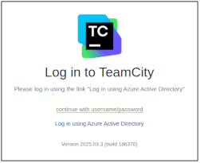
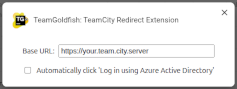
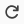

# TeamGoldfish

A browser extension for Google Chrome that returns you to the original page in TeamCity
when Azure Active Directory login is completed.

It can also automatically click the "Log in using Azure Active Directory" link for you when
the `/login.html` page is displayed:

## Installation
Available from the [Chrome Web Store](https://chromewebstore.google.com/detail/teamgoldfish-teamcity-red/lggodijnaahbihdgfaohiaoihjehepdl).

Or, you can install it manually in developer mode:
1. Clone this repository.
2. Open Chrome and type `chrome://extensions/` into the address bar.
3. Make sure the "Developer mode" toggle in the top-right is turned ON.
4. Click the "Load unpacked" button and select the `teamcity-login-redirect-extension` folder that you just cloned.
 
The options screen should appear when you first install your TC server:  

### Upgrading
If it's already installed manually, and you want to pick up the latest changes:
1. Do a regular `git pull`.
2. Open chrome and go to `chrome://extensions/`.
3. Find the "TeamGoldfish: TeamCity Redirect Extension" extension and click the  "Reload" icon.

