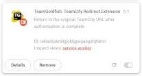

# TeamGoldfish

A browser extension for Google Chrome that returns you to the original page in TeamCity
when Azure Active Directory login is completed.

It can also automatically click the "Log in using Azure Active Directory" link for you when
the `/login.html` page is displayed:

## Installation
Chrome Web Store is coming soon. In the meantime:

1. Clone this repository (or [download as a zip file](https://github.com/michaelomichael/teamcity-login-redirect-extension/archive/refs/heads/main.zip) and unzip it).
2. Open Chrome and click on the  "Extensions" icon in the toolbar and choose
    "Manage extensions" from the pop-up menu. (Alternatively: type `chrome://extensions/` into the address bar).
3. Make sure the "Developer mode" toggle in the top-right is turned ON.
4. Click the "Load unpacked" button and select the `teamcity-login-redirect-extension` folder that you just cloned/unzipped.
5. Find the new entry that appears for "TeamGoldfish: TeamCity Redirect Extension": 
   
     and click its "Details" button. 
6. Scroll down and click on "Extension Options" to enter the base URL of your TC server:  

### Upgrading
If it's already installed, and you want to pick up the latest changes:
1. Do a regular `git pull`.
2. Open chrome and go to `chrome://extensions/`.
3. Find the "TeamGoldfish: TeamCity Redirect Extension" extension and click the  "Reload" icon.

